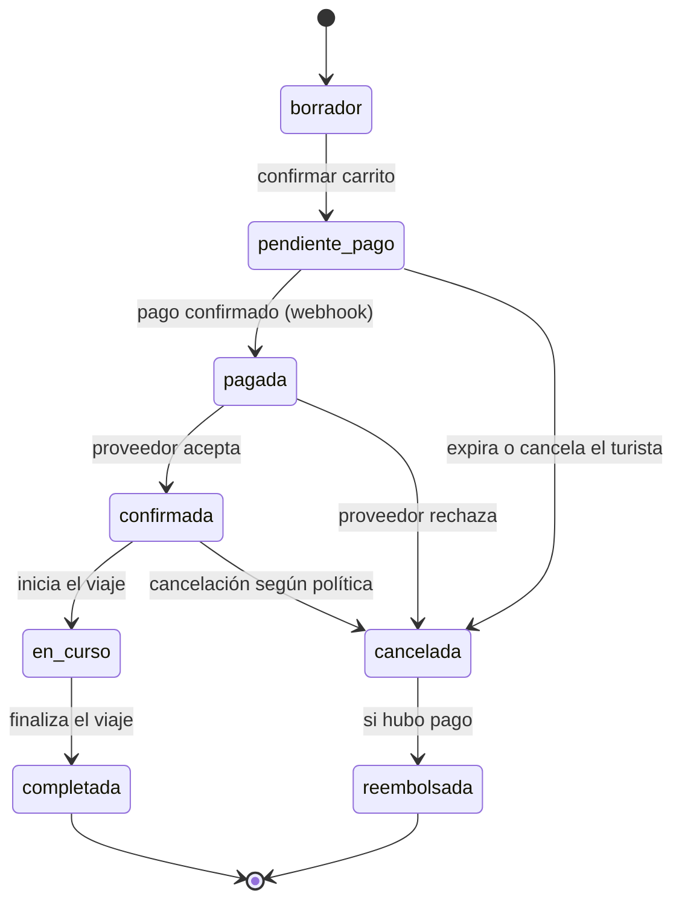

# PLAN DE MODERNIZACIÓN Y ADAPTACIÓN — GQ-Turismo (v2)

**Basado en:** Auditoría Integral del 31/10/2026 y repositorio `etebachale-group/GQ-Turismo` (público, rama `main`, 13 commits, 1 PR abierto).
**Destinatarios:** Responsable del proyecto + agente de código + revisor humano.
**Duración estimada:** 12–14 semanas con 1–2 personas apoyadas por agente.

---

## 0. Cómo usar este documento

- **Límite de fuentes:** el plan se basa en la auditoría y en la estructura pública del repositorio. El código fuente no se ha revisado línea por línea. La Fase 1 verifica cada hallazgo antes de modificar nada (Anexo B).
- **Orden obligatorio:** las fases van en orden. Cada una termina con una **Puerta humana** (sección 8.4) que debe aprobarse antes de seguir.
- **IDs de tarea:** cada tarea tiene un ID (ej. `SEC-03`) que se usa en ramas, commits y PRs.
- **Regla de oro:** no se parchea el sistema actual indefinidamente. Se construye la plataforma nueva de forma incremental, se migran los datos y se hace el corte (patrón *strangler*). Los parches de la Fase 0 son temporales, solo para contener riesgo.

---

## 1. ALERTA PREVIA: acciones de hoy (Fase 0)

**Hallazgo que la auditoría no menciona:** el repositorio es **público**. Además, la **contraseña de la base de datos aparece en texto plano dentro del propio archivo de auditoría**, que también está en el repo. La auditoría, sin querer, amplifica la exposición.

**Consecuencia:** cualquiera que haya visto el repo desde su creación puede tener las credenciales. Borrar el archivo en un commit nuevo **no** elimina el secreto del historial de Git. La única solución real es **rotar la contraseña**.

Ejecutar en este orden:

1. **Backup completo** de la base de datos y de los archivos del servidor (CONT-06). Sin backup no se hace nada más.
2. **Rotar la contraseña** de la base de datos en el panel del hosting y actualizarla en el servidor (CONT-01).
3. **Comprobar si el dump SQL es accesible públicamente.** Abrir `https://<dominio>/if0_39858318_gq_turismo.sql`. Si responde, eliminarlo del servidor y revisar los logs de acceso (CONT-02).
4. **Revisar la base de datos** en busca de cuentas `super_admin` o `agencia` creadas sin aprobación, cambios recientes en usuarios y accesos desconocidos. Resetear contraseñas de administradores y cerrar sesiones activas (CONT-04).
5. **Hacer el repositorio privado**, retirar del árbol el dump SQL, la auditoría y cualquier credencial. Purgar el historial con `git filter-repo` y hacer force push tras coordinarlo con cualquier colaborador (CONT-03).
6. **Hotfix de registro:** forzar `tipo_usuario = 'turista'` en `api/auth.php` (CONT-05).
7. **Notificación:** evaluar con un asesor legal si la exposición del dump (datos personales y hashes de contraseñas) activa obligaciones de notificación según la normativa de protección de datos aplicable en Guinea Ecuatorial y en los países de origen de los usuarios.

> **Nota:** las puntuaciones CVSS de la auditoría son orientativas. Para priorizar, usar el orden de este plan.

---

## 2. DECISIONES ARQUITECTÓNICAS

Cada decisión tiene un **valor por defecto**. Si no se responde, el agente procede con el default y lo registra como ADR (`docs/adr/`).

| # | Decisión | Default recomendado | Alternativa | Cuándo cambiar |
|---|---|---|---|---|
| D1 | Stack backend | **Laravel (versión LTS vigente) sobre PHP 8.3+** | Mantener PHP procedimental (no recomendado) / Node.js + Next.js | Si el equipo domina Node y quiere SPA |
| D2 | Base de datos | **MySQL 8 / MariaDB** con migraciones versionadas | PostgreSQL | Si se necesitan consultas geográficas avanzadas |
| D3 | Hosting | **VPS o cloud con SSH, Composer, cron, HTTPS y backups** | Hosting compartido con panel | **InfinityFree no sirve** para la plataforma objetivo: no ofrece SSH, Composer ni cron fiable |
| D4 | Frontend | **Blade + Tailwind CSS + Alpine.js** (render en servidor, SEO friendly) | Inertia + Vue o React | Si se requiere una experiencia tipo app muy interactiva |
| D5 | Pagos | **Capa de abstracción `PaymentGateway`** con un primer driver según el banco o pasarela disponible en el país | Varios drivers desde el inicio | Confirmar qué pasarelas operan y con qué cuentas. Transferencia con confirmación manual como plan B |
| D6 | Moneda | **XAF (franco CFA)** como base, más **USD/EUR** para turistas internacionales | Solo XAF | Según mercado objetivo |
| D7 | Montos | **Enteros en unidad mínima** (XAF no usa decimales) | `DECIMAL(12,2)` | No recomendado: complica redondeos |
| D8 | Zona horaria | **Africa/Malabo (UTC+1)** | — | — |
| D9 | Idiomas | **Español (obligatorio), francés e inglés**. Portugués opcional | Solo español | Guinea Ecuatorial tiene español, francés y portugués como idiomas oficiales |
| D10 | Mapas | **Leaflet + OpenStreetMap** (sin costo de API) | Google Maps API (requiere clave y facturación) | Si se necesitan funciones exclusivas de Google |
| D11 | Mensajería | **Polling cada 5 s** en la primera versión | Laravel Reverb (WebSockets) | Cuando el volumen lo justifique |
| D12 | Modelo de ingresos | **Comisión por reserva pagada** (% configurable por proveedor) | Suscripción para proveedores o publicidad | Confirmar con el negocio |
| D13 | Repositorio | **Privado**, con `main` protegida | Público | No recomendado |
| D14 | Estrategia de migración | **Strangler**: construir la nueva app, migrar datos, cortar | Parchear el sistema actual | No recomendado |

---

## 3. FLUJO OBJETIVO DE LA PLATAFORMA

La plataforma debe cubrir el viaje completo, de principio a fin.

### 3.1 Actores y roles

| Rol | Descripción | Cómo obtiene la cuenta |
|---|---|---|
| **Turista** | Explora, planifica, reserva y viaja | Registro público (solo `turista`) |
| **Proveedor: Agencia** | Vende paquetes y servicios | Solicitud + aprobación de admin |
| **Proveedor: Guía** | Ofrece guiado por destinos | Solicitud + aprobación de admin |
| **Proveedor: Local** | Restaurante, hotel, tienda, espacio turístico | Solicitud + aprobación de admin |
| **Administrador** | Modera, aprueba, gestiona catálogo y publicidad | Creado solo por otro admin o por consola |

Los roles se gestionan con una tabla de roles y permisos, no con un campo `tipo_usuario` que acepte cualquier valor. Cada proveedor tiene un **perfil** vinculado a `users.id`.

### 3.2 Recorridos (journeys)

1. **Descubrir:** home → buscador → destinos, agencias, guías, locales → detalle → publicidad destacada.
2. **Planificar:** crear itinerario → días y destinos → servicios → mapa del itinerario.
3. **Reservar y pagar:** agregar servicios a la reserva → precios calculados en servidor → pago → confirmación.
4. **Coordinar:** chat turista ↔ proveedor ligado a la reserva, no a un ID suelto.
5. **Viajar:** seguimiento del itinerario por día y por hito → voucher digital.
6. **Valorar:** reseña después del viaje, moderada antes de publicarse.
7. **Operar (proveedor):** catálogo, disponibilidad, recibir y confirmar reservas, ingresos.
8. **Administrar:** aprobar proveedores, moderar, gestionar publicidad, reportes y usuarios.

### 3.3 Ciclo de vida de una reserva



**Regla:** ningún cambio a `pagada` puede venir del navegador. Solo lo confirma el webhook de la pasarela o un admin, con registro de auditoría.

---

## 4. ARQUITECTURA OBJETIVO

### 4.1 Módulos

```
app/
  Domain/
    Identity/        # usuarios, roles, perfiles, aprobaciones
    Catalog/         # destinos, agencias, guías, locales, servicios
    Itinerary/       # itinerarios, días, items, eventos de seguimiento
    Booking/         # reservas, items, disponibilidad, estados
    Payments/        # PaymentGateway, pagos, webhooks, reembolsos
    Messaging/       # conversaciones, participantes, mensajes
    Content/         # banners, reseñas, páginas
  Http/              # controladores finos + Form Requests + policies
  Support/           # archivos, moneda, fechas
```

Los controladores no contienen SQL ni lógica de negocio. La lógica vive en servicios de dominio.

### 4.2 Mapa de tablas: de la base actual al esquema objetivo

| Tablas actuales (según la auditoría) | Tabla objetivo | Notas |
|---|---|---|
| `locales_turisticos` + `lugares_locales` | `locales` | Unificar `nombre`/`nombre_local` y `latitud`/`latitude`. Decidir cuál tiene datos vigentes |
| `carouseles` + `publicidades` + `publicidad_carousel` | `banners` | Tipo, imagen, URL, posición, vigencia, activo |
| `confirmacion_servicios` + `confirmaciones_servicios` | `confirmaciones_servicio` | Deduplicar. Unificar charset en `utf8mb4_unicode_ci` |
| `guias_destinos` + `guia_destinos` + `guia_destinos_disponibles` | `guia_destino` (pivot) + `disponibilidades` | Separar la relación guía–destino de la disponibilidad por fecha |
| `pedidos` + `pedidos_servicios` + `reservas` + `reserva_servicios` | `reservas` + `reserva_items` | Una sola entidad de compra con estados (sección 3.3) |
| `usuarios` + `agencias.id_usuario` + `guias` + `locales` | `users` + perfiles por tipo con `user_id` | **Un solo ID de identidad: `users.id`**. Resuelve el bug de identidad (auditoría 3.2) |
| `messages` (`sender_id` apunta a veces a usuarios y a veces a agencias) | `conversations` + `conversation_participants` + `messages` | Los mensajes apuntan siempre a `users.id` |
| `itinerario_destinos` + `itinerario_servicios` | `itinerario_items` | Día, orden, tipo, referencia polimórfica |
| Estado de seguimiento en `itinerarios` / `itinerario_tracking` | `itinerario_eventos` | Historial de hitos en lugar de sobrescribir |
| `tipo_usuario` (`turista`, `agencia`, `guia`, `local`, `super_admin`) | `roles` + `role_user` | Roles y permisos explícitos |

### 4.3 Diseño de pagos

- Interfaz `PaymentGateway` con `createCheckout`, `handleWebhook` y `refund`.
- El precio de cada `reserva_item` se **copia al momento de la compra** (snapshot) desde la base de datos. Cualquier precio del cliente se ignora.
- Webhooks con verificación de firma, **idempotencia** por ID de evento (tabla `payment_events`) y reintentos.
- Pago manual (transferencia o efectivo, si aplica): el turista sube comprobante privado, un admin lo aprueba y queda en auditoría.
- Conciliación diaria: comparar pagos de la pasarela contra reservas `pagada`.

### 4.4 Diseño de archivos

- Validación real: extensión en lista blanca **y** tipo MIME detectado por contenido **y** `getimagesize()` para imágenes.
- Nombres generados con UUID v4. Nunca el nombre original del usuario.
- Almacenamiento en disco público de Laravel o S3 compatible, **sin ejecución de PHP** en esas rutas.
- Redimensionado y conversión a WebP al subir.
- Comprobantes y vouchers en disco privado, servidos con ruta autenticada.

### 4.5 Seguridad base

- Consultas siempre con Eloquent o query builder con parámetros. Cero concatenación de variables en SQL.
- Asignación masiva protegida con `$fillable` explícito o Form Requests.
- Policies en cada recurso: un proveedor solo ve y edita lo suyo; un turista solo ve sus reservas.
- Toda acción que cambia datos usa `POST`, `PUT` o `DELETE` con token CSRF. Ninguna eliminación por `GET`.
- Confirmación por contraseña para acciones destructivas de admin.
- Rate limiting en login, registro, recuperación de contraseña y chat.
- Cabeceras: CSP, HSTS, `X-Content-Type-Options`, `Referrer-Policy`, `frame-ancestors`.
- Errores sin stack trace en producción. Logs con rotación.
- Secretos solo en `.env`, fuera del repo. `.env.example` sin valores reales.
- Tabla `activity_log` para acciones de admin y cambios de estado de reservas.

### 4.6 Internacionalización

- Textos en `lang/es`, `lang/fr`, `lang/en`. Nunca escritos directamente en las vistas.
- Contenido editable (destinos, servicios) con campos traducibles o tabla de traducciones.
- URLs con prefijo de idioma (`/es/destinos`, `/fr/destinations`).

### 4.7 Observabilidad

- Monitor de disponibilidad sobre home y flujo de reserva.
- Captura de errores (Sentry o equivalente).
- Logs estructurados de pagos y webhooks.
- Alertas por correo o mensajería para errores 5xx y fallos de webhook.

---

## 5. FASES, DURACIÓN Y PUERTAS

| Fase | Nombre | Duración | Entregable principal | Puerta |
|---|---|---|---|---|
| **F0** | Contención | 1–2 días | Credenciales rotadas, repo privado, sistema contenido | G0 |
| **F1** | Descubrimiento y línea base | 1 semana | Inventario, matriz de funcionalidades, hallazgos verificados | G1 |
| **F2** | Fundamentos | 2–3 semanas | Repo, CI, entornos, Laravel, auth, roles, archivos, esquema base | G2 |
| **F3** | Catálogo | 3 semanas | Destinos, agencias, guías, locales, banners, migración de catálogo | G3 |
| **F4** | Itinerarios, reservas y pagos | 3 semanas | Constructor de itinerarios, reservas, pagos, seguimiento | G4 |
| **F5** | Mensajería y paneles | 2 semanas | Chat, paneles de proveedor, turista y admin | G5 |
| **F6** | Experiencia, idiomas y SEO | 2 semanas (en paralelo desde F3) | Design system, i18n, SEO, accesibilidad | G6 |
| **F7** | Calidad, corte y lanzamiento | 1–2 semanas | Pruebas, ensayo de migración, corte, operación | G7 (go-live) |

F3 y F6 pueden solaparse parcialmente. F4 no empieza hasta que G3 esté aprobada.

---

## 6. BACKLOG DE TAREAS

Formato: **ID | Tarea | Criterio de aceptación**. Cada tarea se entrega como rama `feat/ID-descripcion` y un PR que referencia el ID.

### F0: Contención (días 1–2)

| ID | Tarea | Criterio de aceptación |
|---|---|---|
| CONT-01 | Rotar contraseña de BD y cualquier otro secreto | La contraseña anterior no conecta. La nueva está solo en `.env` del servidor |
| CONT-02 | Retirar dump SQL y archivos de prueba del webroot | El `.sql` devuelve 404. `test_*.php`, `verificar_*.php` y `verify_*.php` no son accesibles |
| CONT-03 | Repo privado y purga del historial | `gitleaks detect` sin hallazgos en todo el historial. Auditoría y dump fuera del repo público |
| CONT-04 | Revisión de cuentas y sesiones en BD | Informe de cuentas sospechosas. Admins con contraseña nueva. Sesiones invalidadas |
| CONT-05 | Hotfix de registro | Un POST con `tipo_usuario=super_admin` crea una cuenta `turista` |
| CONT-06 | Backup completo verificado | Backup de BD y archivos restaurado con éxito en un entorno de prueba |
| CONT-07 | Bloqueo de ejecución PHP en `assets/img/` | Subir un `.php` a esa carpeta no ejecuta código (prueba con `curl`) |
| CONT-08 | Revisar el PR abierto | Decisión registrada (fusionar, cerrar o descartar) con motivo |

**Puerta G0:** CONT-01 a CONT-07 completadas y notificación evaluada (sección 1, punto 7).

### F1: Descubrimiento (semana 1)

| ID | Tarea | Criterio de aceptación |
|---|---|---|
| DISC-01 | Inventario de rutas y entry points | `docs/inventario/rutas.md`: archivo, método, requiere login, rol, tablas tocadas |
| DISC-02 | Inventario del esquema | `docs/inventario/esquema-actual.md`: tablas, FK, filas por tabla, tablas sin uso en el código (grep) |
| DISC-03 | Flujos "as-is" | `docs/inventario/flujos.md` con los recorridos actuales de turista, proveedor y admin |
| DISC-04 | Verificación de hallazgos | Cada hallazgo marcado como *confirmado*, *parcial* o *falso positivo*, con archivo y línea (Anexo B) |
| DISC-05 | Matriz de funcionalidades | `docs/inventario/matriz.md`: cada función marcada **Mantener**, **Rehacer** o **Eliminar**, con razón |
| DISC-06 | Dataset de prueba anonimizado | Copia de la BD con datos personales reemplazados. Script de migración de muestra |
| DISC-07 | ADRs de D1–D14 | Un archivo por decisión en `docs/adr/`, en estado *aceptada* o *pendiente* |
| DISC-08 | Personas y métricas | Tres personas (turista, proveedor, admin) y 5 métricas de éxito |

**Puerta G1:** matriz aprobada por el responsable. ADRs aceptadas o con default confirmado.

### F2: Fundamentos (semanas 2–4)

| ID | Tarea | Criterio de aceptación |
|---|---|---|
| FND-01 | Estructura del repo, `AGENTS.md`, plantilla de PR, `.gitignore`, `.env.example` | Ver sección 8. `.env` ignorado por git |
| FND-02 | CI en GitHub Actions | En cada PR: tests, Laravel Pint, Larastan (nivel 6+), `gitleaks`, `composer audit`. Merge solo con CI verde |
| FND-03 | Entornos local, staging y producción | Docker (Laravel Sail) en local. Staging con datos anonimizados. Deploy a producción desde CI |
| FND-04 | Esqueleto Laravel y configuración por entorno | `APP_DEBUG=false` en producción. Logs con rotación. Página de error genérica |
| FND-05 | Esquema objetivo con migraciones | Migraciones según sección 4.2. `migrate:fresh --seed` funciona en local |
| FND-06 | Autenticación | Registro, login, logout, verificación de email, recuperación de contraseña, throttling |
| FND-07 | Roles y policies | Roles turista, proveedor_agencia, proveedor_guia, proveedor_local, admin. Test de policy por recurso |
| FND-08 | Alta de proveedores con aprobación | Solicitud en estado `pendiente`. Admin aprueba o rechaza. Proveedor sin publicar hasta aprobación |
| FND-09 | Servicio de archivos | Validación MIME real, UUID, sin ejecución PHP, WebP, tests con archivos maliciosos |
| FND-10 | Seeders y factories | `db:seed` crea un escenario completo por rol |
| FND-11 | Auditoría de acciones | `activity_log` registra cada acción de admin y cada cambio de estado de reserva |
| FND-12 | CSRF, cabeceras y rate limiting | OWASP ZAP baseline sin alertas altas. Formularios con token CSRF |

**Puerta G2:** CI verde, esquema aprobado, auth y roles con tests, FND-12 sin alertas altas.

### F3: Catálogo (semanas 5–7)

| ID | Tarea | Criterio de aceptación |
|---|---|---|
| CAT-01 | Destinos: CRUD admin, galería, slug, búsqueda y filtros | Crear, editar y eliminar (POST + CSRF + confirmación) funcionan. Búsqueda por nombre y región |
| CAT-02 | Agencias: perfil, servicios y aprobación | Solo agencias aprobadas aparecen en el sitio público |
| CAT-03 | Guías: perfil, idiomas, destinos y disponibilidad | Un guía solo edita su perfil. Filtro por idioma y destino |
| CAT-04 | Locales: negocios, geolocalización y categorías | Unifica `locales_turisticos` y `lugares_locales`. Coordenadas válidas |
| CAT-05 | Servicios y tarifas en base de datos | Cada servicio tiene precio y moneda en BD. Ningún precio viene del cliente |
| CAT-06 | Banners unificados | Un solo módulo de publicidad con vigencia y posición |
| CAT-07 | Migración del catálogo | Conteos por tabla coinciden. Muestreo manual de 30 registros sin diferencias |
| CAT-08 | Páginas públicas de catálogo | Home, destinos, agencias, guías, locales y búsqueda. Carga inicial < 2,5 s en 4G simulado |

**Puerta G3:** migración de catálogo reconciliada en staging. Aprobación del responsable de contenido.

### F4: Itinerarios, reservas y pagos (semanas 8–10)

| ID | Tarea | Criterio de aceptación |
|---|---|---|
| ITI-01 | Constructor de itinerarios | Días, orden de destinos y servicios. Fecha fin ≥ fecha inicio |
| ITI-02 | Mapa del itinerario | Marcadores y ruta por día con Leaflet. Funciona en móvil |
| ITI-03 | Seguimiento por hitos | Historial en `itinerario_eventos`. Estado del día visible para el turista |
| RES-01 | Carrito y reserva | Precios calculados en servidor. Snapshot por item. Test de manipulación de precio (debe fallar) |
| RES-02 | Máquina de estados | Solo las transiciones de la sección 3.3. Test para cada transición inválida |
| RES-03 | Disponibilidad sin sobreventa | Bloqueo transaccional. Test de concurrencia con dos solicitudes simultáneas |
| RES-04 | Confirmación al turista | Email con resumen y código. Voucher descargable en PDF |
| PAY-01 | Interfaz `PaymentGateway` y primer driver | Checkout completo en sandbox del proveedor elegido |
| PAY-02 | Webhooks | Firma verificada. Evento duplicado no duplica el pago (test de idempotencia) |
| PAY-03 | Cancelaciones y reembolsos | Política configurable por servicio. Reembolso registrado |
| PAY-04 | Pago manual con comprobante (si aplica) | Comprobante privado. Aprobación de admin con auditoría |
| PAY-05 | Conciliación diaria | Comando `payments:reconcile` que reporta diferencias |

**Puerta G4:** flujo completo en sandbox aprobado. Concurrencia probada. Cero precios aceptados desde el cliente.

### F5: Mensajería y paneles (semanas 11–12)

| ID | Tarea | Criterio de aceptación |
|---|---|---|
| MSG-01 | Conversaciones ligadas a reservas | Un chat por reserva o por par de usuarios. Mensajes apuntan a `users.id`. Corrige el bug de identidad |
| MSG-02 | Entrega de mensajes | Polling cada 5 s con respuesta 304 si no hay cambios. Sin duplicados al refrescar |
| MSG-03 | Moderación y bloqueo | Un usuario bloqueado no puede escribir. Admin ve reportes |
| PNL-01 | Panel del proveedor | Reservas pendientes, ingresos y disponibilidad. Confirmar o rechazar |
| PNL-02 | Panel del turista | Mis viajes, reservas, vouchers, mensajes y reseñas |
| ADM-01 | Panel admin | Aprobaciones, usuarios, publicidad y reportes. Eliminación con POST + CSRF + contraseña |
| ADM-02 | Reseñas moderadas | Reseña solo tras reserva completada. Moderación antes de publicar |
| ADM-03 | Correos en cola | Confirmaciones, aprobaciones y recordatorios por cola con reintentos |

**Puerta G5:** recorrido de turista y proveedor de punta a punta en staging, aprobado por usuarios piloto.

### F6: Experiencia, idiomas y SEO (en paralelo desde F3)

| ID | Tarea | Criterio de aceptación |
|---|---|---|
| UX-01 | Design system | Tokens de color, tipografía y espaciado. Componentes base. Reemplaza los 10 CSS móviles y el abuso de `!important` |
| UX-02 | Mobile first | Revisión en 360, 390 y 768 px sin scroll horizontal |
| UX-03 | Accesibilidad WCAG 2.1 AA | Contraste ≥ 4.5:1, navegación por teclado, formularios etiquetados. axe sin errores críticos |
| UX-04 | Internacionalización ES/FR/EN | Ningún texto escrito en vistas. Selector de idioma funcional |
| UX-05 | Rendimiento | Imágenes WebP, lazy loading, caché de catálogo. Core Web Vitals en verde en móvil |
| SEO-01 | SEO técnico | Títulos y meta descripciones únicos, sitemap XML, URLs amigables, `hreflang` |
| SEO-02 | Datos estructurados | Schema.org: `TouristAttraction`, `LocalBusiness`, `TravelAgency` |

### F7: Calidad, corte y lanzamiento (semanas 13–14)

| ID | Tarea | Criterio de aceptación |
|---|---|---|
| QA-01 | Regresión E2E | Playwright cubre los recorridos de la sección 3.2. Corre en cada PR contra staging |
| QA-02 | Pruebas de seguridad | OWASP ZAP sin alertas altas. Pruebas manuales de IDOR, asignación masiva, precios y subida de archivos |
| QA-03 | Pruebas de carga | k6 en el flujo de reserva con 3× la carga esperada, sin errores 5xx |
| QA-04 | Ensayo de corte | Migración completa en staging, medida en minutos. Rollback probado |
| OPS-01 | Backups automáticos | Backup diario cifrado. Restauración probada una vez al mes |
| OPS-02 | Monitorización y alertas | Uptime, errores, fallos de webhook y de cola con alerta |
| OPS-03 | Corte a producción | Modo mantenimiento, migración final, deploy, humo, fin de mantenimiento |
| OPS-04 | Plan de rollback | Procedimiento escrito con criterios de disparo. Probado en staging |
| OPS-05 | Documentación | `docs/operacion/runbook.md` y guía de usuario por rol |

**Puerta G7 (go-live):** checklist de la sección 9.2.

---

## 7. DATOS Y MIGRACIÓN

1. **Extracción:** exportar la BD actual completa, cifrada, desde el servidor. Nunca desde el repo.
2. **Anonimización** para staging y desarrollo: nombres, correos, teléfonos y documentos reemplazados por datos ficticios. Las contraseñas se sustituyen por un hash de prueba conocido. **Nunca usar datos reales en local.**
3. **Migración por dominio**, en este orden: usuarios → proveedores → catálogo → itinerarios → reservas históricas → mensajes.
4. **Reconciliación** después de cada dominio: conteos, sumas de precios y muestreo manual.
5. **Reservas y pagos históricos:** se migran como registros de solo lectura con su estado final. No se reprocesan pagos.
6. **Corte:** ventana acordada, modo mantenimiento, migración final incremental y validación. Rollback: volver a apuntar el dominio a la versión anterior en modo lectura.

---

## 8. FLUJO DE TRABAJO CON EL AGENTE

### 8.1 Estructura del repositorio

```
GQ-Turismo/
├── AGENTS.md                 # Reglas para el agente (ver 8.2)
├── docs/
│   ├── adr/                  # Decisiones de arquitectura
│   ├── inventario/           # Resultados de F1
│   ├── operacion/            # Runbook, backups, rollback
│   └── usuario/              # Guías por rol
├── tasks/                    # Una tarea por archivo: ID.md
├── .github/
│   ├── workflows/ci.yml
│   └── pull_request_template.md
└── (código Laravel)
```

Las tareas del backlog se copian a `tasks/` con el formato de la sección 8.3, para que el agente las lea desde el repositorio.

### 8.2 `AGENTS.md`

```markdown
# Reglas para agentes en GQ-Turismo

## Prohibido
- Commitear secretos, contraseñas, dumps SQL o archivos `.env`.
- Tocar la base de datos de producción. Solo staging o local con datos anonimizados.
- Ejecutar `migrate:fresh`, `db:wipe` o cualquier comando destructivo fuera de local.
- Hacer push directo a `main`. Todo cambio va por PR.
- Desactivar, saltar o borrar tests para que el CI pase.
- Aceptar precios, roles o IDs de propietario enviados por el cliente.
- Eliminar datos por GET.
- Usar `DB::statement` o `DB::select` con variables sin bindings.

## Obligatorio
- Una tarea = una rama `feat/ID-descripcion` = un PR.
- Antes de codear: leer la tarea completa, los ADR relacionados y `docs/inventario/matriz.md`.
- Escribir primero el test que falla y luego el código.
- Ejecutar `composer test`, `./vendor/bin/pint --test` y `./vendor/bin/phpstan analyse` antes de abrir el PR.
- Si una decisión no está en un ADR, detenerse y preguntar.
- Si una tarea exige tocar algo fuera de su alcance, anotarlo en el PR y no hacerlo.

## Entregable de cada tarea
1. Resumen de cambios (qué y por qué).
2. Lista de archivos modificados.
3. Evidencia de tests (salida o enlace al CI).
4. Riesgos y pendientes.
5. Pasos para verificar manualmente.
```

### 8.3 Plantilla de tarea (`tasks/ID.md`)

```markdown
# ID: Título

**Fase:** F2 · **Prioridad:** Alta · **Depende de:** FND-04

## Contexto
Por qué existe, con referencia a la auditoría o a la matriz.

## Alcance
- Incluye: ...
- No incluye: ...

## Criterios de aceptación
- [ ] ...
- [ ] ...

## Verificación
- Comando: `composer test --filter=...`
- Prueba manual: ...

## Notas de seguridad
Qué podría salir mal y cómo se evita.
```

### 8.4 Ciclo por tarea y puertas humanas

```
Tarea lista → Agente lee tarea + ADR + matriz → Plan breve (3–5 líneas)
  → Tests que fallan → Implementación → Tests verdes + lint + análisis estático
  → PR con plantilla → CI verde → Revisión humana → Merge a main → Deploy a staging
```

**Puertas (G0–G7):** al terminar una fase, el agente entrega un informe de cierre con el checklist de la fase. El responsable aprueba o rechaza por escrito. **Ninguna fase arranca sin aprobación de la anterior.**

### 8.5 Ambientes y ramas

| Ambiente | Datos | Quién despliega | Cuándo |
|---|---|---|---|
| Local (Sail) | Seeders y dataset anonimizado | Desarrollador | Continuo |
| Staging | Dataset anonimizado | CI al hacer merge a `main` | Continuo |
| Producción | Reales | CI con aprobación manual | Solo tras G7 |

Ramas: `main` protegida. `feat/ID-…` para tareas. `hotfix/ID-…` para incidentes. Squash merge.

---

## 9. DEFINICIÓN DE TERMINADO Y CHECKLIST DE LANZAMIENTO

### 9.1 Definición de terminado (DoD) por tarea

- [ ] Criterios de aceptación cumplidos.
- [ ] Tests nuevos y existentes en verde.
- [ ] Lint y análisis estático sin errores.
- [ ] Sin secretos ni datos reales en el código.
- [ ] Documentación actualizada si cambia un flujo o una decisión.
- [ ] Revisado por una persona.

### 9.2 Checklist de go-live (G7)

- [ ] Todas las tareas F0–F6 en DoD.
- [ ] Cada fila de la matriz marcada **Mantener** o **Rehacer** está verificada.
- [ ] Regresión E2E en verde en staging.
- [ ] OWASP ZAP sin alertas altas. Pruebas manuales de seguridad documentadas.
- [ ] Ensayo de corte completado dentro de la ventana acordada.
- [ ] Backup previo al corte verificado.
- [ ] Rollback probado.
- [ ] Monitorización y alertas activas.
- [ ] Pasarela de pago en producción con webhook verificado.
- [ ] Textos legales (privacidad, términos, cancelación) publicados en los idiomas activos.
- [ ] Contenido inicial cargado y revisado por el responsable de contenido.
- [ ] Usuarios piloto aprobaron los recorridos críticos.
- [ ] Runbook y guía de usuario publicados.

---

## 10. RIESGOS

| Riesgo | Prob. | Impacto | Mitigación |
|---|---|---|---|
| Credenciales ya usadas por terceros | Media | Alto | Rotación inmediata (CONT-01), revisión de BD (CONT-04), notificación evaluada |
| Pérdida de datos en la migración | Media | Alto | Ensayos repetidos, reconciliación por dominio, backup previo, rollback |
| Sobreventa de servicios | Alta sin control | Alto | Bloqueo transaccional y test de concurrencia (RES-03) |
| Pasarela de pago no disponible en el país | Media | Alto | Pago manual con comprobante (PAY-04) como plan B |
| Hosting actual no soporta el stack | Alta | Medio | Migrar a VPS en F2 (D3) |
| El agente introduce cambios fuera de alcance | Media | Medio | Reglas en `AGENTS.md`, PR pequeños, revisión humana |
| Cambio de alcance durante el desarrollo | Alta | Medio | Matriz aprobada en G1. Cambios por ADR nuevo |
| Contenido (fotos, textos) incompleto al lanzar | Media | Medio | Responsable de contenido asignado desde F3 |
| Proveedores no adoptan los paneles | Media | Medio | Pruebas con proveedores reales en G5 |

---

## 11. PRIMEROS PASOS (HOY)

1. Ejecutar la **sección 1** completa, en orden. No avanzar al código hasta CONT-06 (backup) y CONT-01 (rotación).
2. Crear el repo de trabajo privado y copiar `AGENTS.md` (sección 8.2) a la raíz.
3. Ejecutar el **prompt de arranque de F0 y F1** (sección 12.1) con el agente.
4. Responder las decisiones D1–D14 o confirmar los defaults.

---

## 12. PROMPTS DE ARRANQUE PARA EL AGENTE

### 12.1 Fase 0 y Fase 1

```
Lee AGENTS.md y AUDITORIA_INTEGRAL_PLATAFORMA_GQ_TURISMO.md.

Objetivo: ejecutar CONT-01 a CONT-08 y DISC-01 a DISC-08.

Reglas:
1. Antes de cambiar nada, entrega un informe de estado: rama actual, PRs abiertos, archivos sensibles presentes y, si hay acceso, tablas y tamaños de la BD de staging.
2. No toques la base de datos de producción. Describe cualquier acción sobre producción y déjala para que la ejecute una persona.
3. Para CONT-03 (purga del historial), prepara comandos y plan, pero no hagas force push hasta que yo lo confirme.
4. En DISC-04, verifica cada hallazgo contra el código real con grep y lectura de archivos. Marca cada uno como confirmado, parcial o falso positivo, con archivo y línea.
5. Cada tarea va en su propia rama y su propio PR.
6. Al terminar F0, detente y entrega el informe de cierre de G0 para mi aprobación antes de seguir con F1.
```

### 12.2 Fase 2 (plantilla)

```
Lee AGENTS.md, docs/adr/ y docs/inventario/matriz.md.

Ejecuta FND-01 a FND-04 en ese orden. Una tarea por rama y PR.
Para cada tarea: plan de 3–5 líneas, tests primero, implementación y verificación según la plantilla de tasks/.
Al terminar, entrega el informe de cierre de G2 con el estado de cada punto del checklist de la fase.
No avances a FND-05 sin mi aprobación de FND-04.
```

### 12.3 Fases 3 a 7

Repetir la plantilla 12.2 cambiando el rango de IDs y la puerta. Antes de cada fase, pedir al agente que proponga el orden de sus tareas y sus dependencias.

---

## ANEXO A: Mapeo de hallazgos de la auditoría a tareas

| Hallazgo (auditoría) | Tarea(s) |
|---|---|
| 1. Credenciales y BD completa en Git y webroot | CONT-01, CONT-02, CONT-03, CONT-06 |
| 2. Elevación a `super_admin` en registro | CONT-04, CONT-05, FND-07, FND-08 |
| 3. RCE por carga de archivos | CONT-07, FND-09 |
| 4. SQL injection en DELETE y UPDATE | FND-05, FND-12, RES-01 (consultas parametrizadas) |
| 5. Alteración de precios desde el cliente | CAT-05, RES-01, PAY-02 |
| 6. Eliminación de usuarios por GET sin CSRF | ADM-01, FND-12 |
| 7. Código de sesión huérfano | FND-06, FND-12 |
| 3.1 Tablas duplicadas | FND-05, sección 4.2, CAT-04, CAT-06 |
| 3.2 Bug de identidad proveedor vs. usuario | FND-05, MSG-01 |
| 3.3 46 scripts de fixes sin migraciones | FND-05, DISC-02 (retirar scripts) |
| 4.1 Código procedimental sin capas | Sección 4.1, todas las fases |
| 4.1 Pago simulado (`pagar.php`) | PAY-01 a PAY-05 |
| 4.2 Diez CSS móviles superpuestos | UX-01, UX-02 |
| 4.3 Archivos de prueba, `trash/` e `informe/` | CONT-02, DISC-05 |

---

## ANEXO B: Verificación de hallazgos (DISC-04)

Cada punto debe confirmarse con evidencia antes de darlo por cierto:

| Afirmación | Cómo verificarla |
|---|---|
| `includes/session_security.php` no es incluido por ningún archivo | `grep -r "session_security" .` |
| No existe `.htaccess` en `assets/img/` | Revisar la carpeta. El repo sí tiene `.htaccess` en la raíz |
| `$_POST['tipo_usuario']` se acepta sin validar en el registro | Leer `api/auth.php` |
| `move_uploaded_file()` sin validación de extensión ni MIME | Leer los `admin/manage_*.php` citados |
| `DELETE` con variable sin casteo en `api/itinerarios.php` | Leer las líneas citadas. Verificar de dónde viene la variable |
| Precio enviado por el cliente en `api/pedidos.php` | Leer las líneas citadas y el flujo completo de compra |
| `pagar.php` no integra pasarela | Leer el archivo y buscar llamadas HTTP externas |
| Bug de identidad en el chat | Reproducir: iniciar sesión como agencia y revisar `get_conversation.php` |
| Dos conjuntos de tablas con charset distinto | Consultar `information_schema.TABLES` en staging |

Si un hallazgo resulta **falso positivo**, se documenta y se quita del plan. Si resulta **parcial**, se ajusta el alcance de la tarea.

---

## ANEXO C: Glosario

- **Strangler:** reemplazo gradual en el que la aplicación nueva crece mientras la anterior sigue en operación, hasta sustituirla por completo.
- **ADR:** *Architecture Decision Record*. Documento corto que registra una decisión técnica, su contexto y sus consecuencias.
- **IDOR:** acceso a recursos ajenos cambiando un identificador en la URL o en la petición.
- **Asignación masiva (*mass assignment*):** el cliente envía campos que el servidor no debería aceptar.
- **Snapshot de precio:** copia del precio al momento de la compra, para que los cambios posteriores no alteren pedidos ya hechos.
