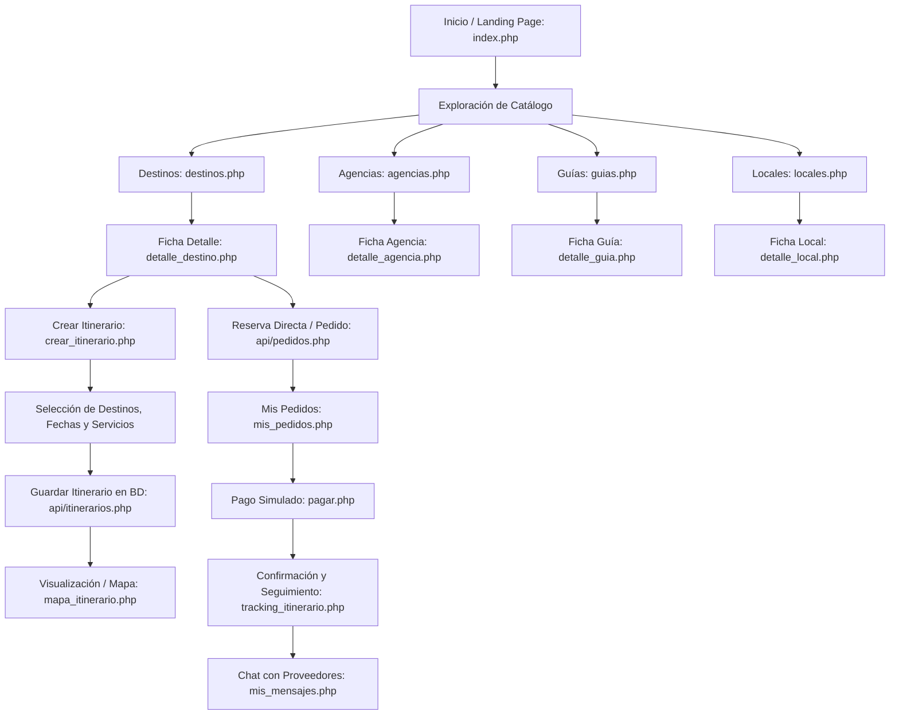
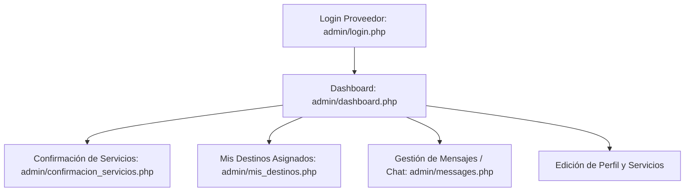
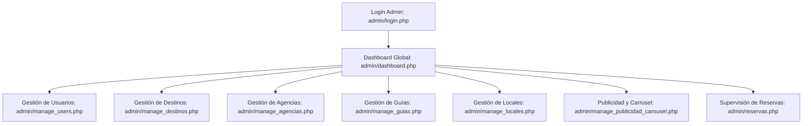

# FLUJOS ACTUALES "AS-IS" DEL SISTEMA (DISC-03)

**Proyecto:** GQ-Turismo  
**Fecha:** 31 de Octubre de 2026  
**Objetivo:** Documentar los recorridos funcionales actuales de cada tipo de usuario antes de la modernización.

---

## 1. Recorrido del Turista (Viajero)

### Detalle de Pasos Actuales:
1. **Descubrimiento:** El turista entra a `index.php`, busca destinos por categoría o ciudad, y consulta listados de agencias, guías y locales.
2. **Consulta de Detalle:** En `detalle_destino.php`, visualiza descripción, galería de imágenes y sugerencias de guías y locales cercanos.
3. **Planificación (Itinerarios):**
   - Accede a `crear_itinerario.php` (requiere login como `turista`).
   - Define título, ciudad, fechas y selecciona destinos con checkboxes.
   - Selecciona servicios de guías, agencias y locales.
   - El frontend envía JSON a `api/itinerarios.php`.
4. **Reserva y Contratación:**
   - Desde la ficha o el itinerario, se genera un pedido en `pedidos_servicios` vía `api/pedidos.php`.
   - **Falla actual:** El cliente envía los precios en el payload y se registran sin verificar contra la BD.
5. **Pago:**
   - Accede a `pagar.php?id=X`.
   - Al pulsar "Pagar", un `UPDATE` local cambia el estado a `completado` sin pasar por pasarela real.
6. **Coordinación y Mensajería:**
   - En `mis_mensajes.php`, consulta y envía mensajes vía `api/get_conversation.php` y `api/messages.php`.
   - **Falla actual:** Los remitentes/destinatarios proveedores no coinciden si se busca por `id` en vez de `id_usuario`.

---

## 2. Recorrido del Proveedor (Agencia, Guía o Local)

### Detalle de Pasos Actuales:
1. **Autenticación:** Inicia sesión con credenciales de usuario con rol `agencia`, `guia` o `local`.
2. **Dashboard de Operaciones:** En `admin/dashboard.php`, visualiza métricas de pedidos pendientes y completados.
3. **Confirmación de Servicios:**
   - En `admin/confirmacion_servicios.php`, el proveedor ve los pedidos asignados a su ID.
   - Puede cambiar el estado a `confirmado` o `rechazado` vía `api/confirmar_servicio_proveedor.php`.
4. **Gestión de Disponibilidad / Destinos:**
   - Los guías acceden a `admin/mis_destinos.php` para asociarse o desvincularse de destinos turísticos.
5. **Comunicación:**
   - En `admin/messages.php`, responden consultas de turistas interesados en sus servicios.

---

## 3. Recorrido del Super Administrador

### Detalle de Pasos Actuales:
1. **Control de Usuarios:** En `admin/manage_users.php`, el administrador puede cambiar roles (`turista`, `guia`, `agencia`, `local`, `super_admin`) o eliminar cuentas.
2. **Gestión de Catálogo (CRUDs):**
   - Crea, edita y elimina registros en `destinos`, `agencias`, `guias_turisticos` y `lugares_locales`.
   - Carga imágenes para cada entidad.
3. **Publicidad:**
   - En `admin/manage_publicidad_carousel.php`, gestiona banners que se muestran en el carrusel de la página de inicio.
4. **Monitoreo de Reservas:**
   - En `admin/reservas.php`, consulta todas las reservas globales registradas en el sistema.
